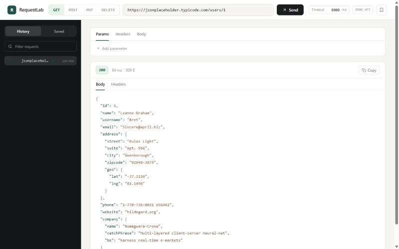

# RequestLab — API Explorer

A small, browser-based API tester with the look and feel of a developer tool. Built as a portfolio piece to show two things: a React UI that stays thin, and a networking layer that's designed, tested, and used independently of that UI.



## What it does

- Send `GET`, `POST`, `PUT` and `DELETE` requests.
- Edit the URL, query parameters, headers and a JSON body — each param/header row can be individually enabled or disabled without deleting it.
- See the status code, response time, response size and a syntax-highlighted, pretty-printed JSON body (or raw text if it isn't JSON).
- Live "Effective URL" preview: see exactly what URL + query string will be sent, before you send it.
- Request history (persisted) and saved requests (persisted), both filterable and one click away from reloading into the composer.
- Loading state, a configurable timeout, and a Cancel button that actually aborts the in-flight request.
- Every failure mode is a distinct, visible state: a network error, a timed-out request, a cancelled request and an invalid JSON body all render differently — nothing just silently fails.

The default request points at [jsonplaceholder.typicode.com](https://jsonplaceholder.typicode.com), a public, CORS-enabled test API, so the app works the moment you open it — no backend to stand up, no API key to configure.

## Why it's built this way

The interesting part of an API client isn't the UI — it's building and sending the request correctly, and handling everything that can go wrong. So that logic lives in [`src/api-client`](src/api-client), a module with **no dependency on React**:

- [`buildRequest`](src/api-client/buildRequest.ts) — a pure function: `RequestDraft → { url, init } | error`. No network, so it's trivial to unit test and it's what powers the "Effective URL" preview and the `toCurl` export.
- [`sendRequest`](src/api-client/sendRequest.ts) — sends the built request, enforces the timeout via `AbortSignal.any(...)`, and always *resolves* (never throws) with a tagged result:

  ```ts
  type ApiResult =
    | { ok: true; response: ApiResponse }
    | { ok: false; error: { kind: 'network' | 'timeout' | 'aborted' | 'invalid-request' | 'invalid-json'; message: string } }
  ```

  The UI never has to guess what went wrong — it switches on `error.kind`.
- [`toCurl`](src/api-client/toCurl.ts) — turns a built request into a copy-pasteable `curl` command, essentially free once the request is already a pure data structure.

The React layer ([`src/components`](src/components), [`src/hooks/useRequestLab.ts`](src/hooks/useRequestLab.ts)) only calls into this module and renders whatever it gets back.

CORS is a real constraint for a browser-only tool like this — it can't talk to arbitrary APIs, only ones that allow cross-origin requests. The app leans into that rather than hiding it: the default endpoint is CORS-enabled, and a blocked cross-origin request still surfaces as a clear "Network error" rather than a silent failure.

## Live demo

Deployed via GitHub Pages: **https://iramilcsevics.github.io/request-lab/**

Pushing to `main` runs [`.github/workflows/deploy.yml`](.github/workflows/deploy.yml), which installs, tests, builds and publishes `dist/` — so a broken build or a failing test never reaches the live site.

## Running it

```bash
npm install
npm run dev
```

```bash
npm run test    # vitest, once
npm run build   # typecheck + production build
```

## Stack

- **React 19 + TypeScript** (strict), **Vite**
- **Vitest + Testing Library + MSW** for tests — `api-client` is tested in isolation with mocked network responses (success, non-JSON body, network error, timeout, user-initiated abort); component tests cover the composer, the response panel's error states, and tab/param interactions.
- **CSS Modules**, no UI framework.
- Persistence (history, saved requests) via `localStorage`, behind a small wrapper that degrades gracefully if storage is unavailable.

## Project structure

```
src/
  api-client/     network layer — framework-agnostic, fully unit tested
  lib/            small pure helpers (JSON formatting/highlighting, byte
                   formatting, relative time, status→tone mapping, ...)
  hooks/          useRequestLab — the app's state, wired to api-client
  components/     TopBar, Sidebar, RequestComposer, ResponsePanel, ...
  types/          UI-only types (history entries, saved requests, tabs)
```
